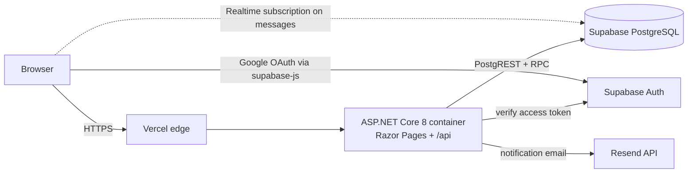
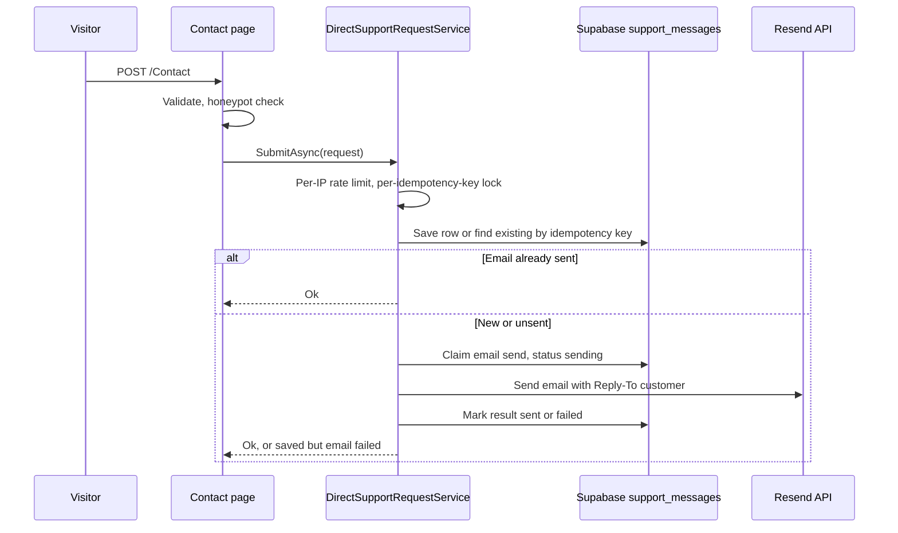

<div align="center">

# LED Support Web

**Technical support website and customer portal for LED screen control systems (Colorlight, NovaStar, Huidu).**
<br/>
<sub>LED ekran kontrol sistemleri (Colorlight, NovaStar, Huidu) için teknik destek sitesi ve müşteri portalı.</sub>

<br/><br/>

[](src/LedSupport.Web/LedSupport.Web.csproj)
[](src/LedSupport.Web/Pages)
[](docs/supabase)
[](src/LedSupport.Web/Services/ResendEmailService.cs)
[](vercel.json)
[](https://asp-net-app-for-led.vercel.app)

<a href="https://asp-net-app-for-led.vercel.app"><b>Live site · Canlı site</b></a>

<p><a href="#english">English</a> · <a href="#turkce">Türkçe</a></p>


</div>

| | |
|---|---|
| **Type · Tür** | Web application: public support site + customer portal + admin panel · Web uygulaması: tanıtım/destek sitesi + müşteri portalı + yönetim paneli |
| **Status · Durum** | Live, maintained by one developer · Yayında, tek geliştirici tarafından sürdürülüyor |
| **Stack · Teknoloji** | .NET 8, ASP.NET Core Razor Pages + minimal APIs, Supabase (PostgreSQL, Auth, Realtime), Resend, Docker, Vercel |
| **Category · Kategori** | Live side project for the LED display industry · LED ekran sektörü için yayında olan yan proje |
| **UI language · Arayüz dili** | Turkish · Türkçe |
| **Tests / CI · Test / CI** | None yet · Henüz yok |

---

<a id="english"></a>

## English

- [Overview](#en-overview)
- [Problem and solution](#en-problem)
- [Features](#en-features)
- [Tech stack](#en-stack)
- [Architecture](#en-architecture)
- [Repository structure](#en-structure)
- [Data and auth](#en-data)
- [Getting started](#en-setup)
- [Deployment](#en-deploy)
- [Testing and CI](#en-testing)
- [Screenshots](#en-screenshots)
- [Engineering notes](#en-notes)
- [Limitations](#en-limitations)
- [Project status and contributions](#en-status)

<a id="en-overview"></a>
### Overview

LED Support Web is a Turkish-language website for an LED screen technical-support service. It has three parts:

- **Public site.** Visitors read about the supported LED control systems (Colorlight, NovaStar, Huidu) and AnyDesk remote support, and send a request through a contact form.
- **Customer portal.** Customers sign in with Google, open support requests, follow their status and chat with the operator about each request in real time.
- **Admin panel.** The operator sees customers, requests and conversations in one place and replies from there.

The UI text is Turkish; code, configuration keys and comments are English.

<a id="en-problem"></a>
### Problem and solution

**Problem.** LED screen support is often handled ad hoc over phone and messaging apps. Requests get lost, there is no history per customer, and the operator has no single place to see what is open.

**Solution.** One web application that:

1. Stores every contact-form submission in PostgreSQL *before* sending the notification email, so a failed email does not lose the request.
2. Gives signed-in customers a request list and a per-request chat that updates live.
3. Gives the operator an admin panel over the same data, protected by a role check.

<a id="en-features"></a>
### Features

| Area | Capability | Where |
|---|---|---|
| Public site | Home, Services and Contact pages; `/Products` and `/Support` permanently redirect to `/Services` for old URLs | `Pages/Index`, `Pages/Services`, `Pages/Contact`, `Pages/Products.cshtml.cs`, `Pages/Support.cshtml.cs` |
| Public site | Content for Colorlight, NovaStar and Huidu control systems and AnyDesk remote support | `Pages/Shared/_ControlSystems.cshtml`, `_AnyDeskSupport.cshtml` |
| Contact form | Server-side validation, honeypot field, idempotency key, per-IP rate limit (default 3 per 15 minutes) | `Pages/Contact.cshtml.cs`, `Services/DirectSupportRequestService.cs` |
| Contact pipeline | Save to `support_messages` first, then email the operator through Resend with `Reply-To` set to the customer | `Services/SupabaseSupportRequestStore.cs`, `Services/ResendEmailService.cs` |
| Contact pipeline | Per-row email status (`pending`, `sending`, `sent`, `failed`) and a "claim" step so a repeated submission does not send two emails | `Services/SupabaseSupportRequestStore.cs`, `docs/supabase/support_messages.sql` |
| Customer portal | Google sign-in via Supabase Auth; the server verifies the access token and issues its own HTTP-only cookie | `Pages/Giris*`, `wwwroot/js/auth-*.js`, `Services/AuthCookieService.cs` |
| Customer portal | Account page: profile update, sign-out, account deletion | `Pages/Hesap.cshtml.cs` |
| Customer portal | Create support requests and see their status | `Pages/Talepler.cshtml.cs`, `Services/CustomerRequestStore.cs` |
| Realtime chat | Messages are written through the ASP.NET API; new ones appear through a Supabase Realtime subscription on `messages` | `Pages/Destek.cshtml`, `wwwroot/js/chat.js`, `Services/SupabaseChatStore.cs` |
| Notifications | Operator email when a customer creates a request or sends a message | `Services/ResendEmailService.cs` |
| Admin panel | Dashboard counts, request list with status filter, customer list and detail, conversation view with reply and status change | `Pages/Admin/*` |
| JSON API | Cookie-authenticated `/api` endpoints for profile, requests, conversations, messages and mark-as-read; `/api/admin` listings for admins; `401`/`403` instead of redirects | `Api/SupportApi.cs` |
| SEO | Titles, meta descriptions, canonical and Open Graph tags, `robots.txt`, `sitemap.xml` | `Pages/Shared/_Layout.cshtml`, `wwwroot/` |

<a id="en-stack"></a>
### Tech stack

| Layer | Technology |
|---|---|
| Web framework | ASP.NET Core 8 (Razor Pages + minimal API endpoints), C# |
| Front end | Server-rendered Razor views, Bootstrap 5.3 (CDN, with SRI), custom CSS, vanilla JavaScript, `supabase-js` v2 (CDN) |
| Data | Supabase PostgreSQL through the PostgREST HTTP API (no ORM), row-level security, RPC functions |
| Auth | Supabase Auth with Google OAuth; ASP.NET Core cookie authentication for the app session |
| Realtime | Supabase Realtime (`postgres_changes` on `public.messages`) |
| Email | Resend HTTP API |
| Hosting | Docker image on Vercel's container runtime (`Dockerfile.vercel`) |

The project references no NuGet packages beyond the ASP.NET Core shared framework; Supabase and Resend are called with typed `HttpClient`s registered in `Program.cs`.

<a id="en-architecture"></a>
### Architecture



*System context: the browser talks to the app for pages and writes, and to Supabase directly only for sign-in and live chat updates.*

Contact-form flow, from `Pages/Contact.cshtml.cs` and `DirectSupportRequestService`:



*The row is stored before any email is attempted, so an email outage never loses a request.*

<a id="en-structure"></a>
### Repository structure

```text
src/LedSupport.Web/
  Pages/          Razor Pages: public site, sign-in, account, requests, chat, Admin/
  Api/            Minimal API endpoints under /api (SupportApi.cs)
  Services/       Supabase stores, account service, Resend email, auth cookie helper
  Options/        Strongly typed settings (Site, Support, Supabase, Resend, Smtp)
  wwwroot/        CSS, JS (auth, chat, contact), images, robots.txt, sitemap.xml
docs/supabase/    SQL snapshots: tables, RLS policies, triggers, Realtime publication
docs/screenshots/ Screenshots used in this README
scripts/          PowerShell helper that sets local user-secrets interactively
legacy/           Earlier ASP.NET Core MVC prototype, kept for reference (not built or deployed)
Dockerfile        Production image for any Docker host
Dockerfile.vercel Same build with Vercel-specific environment defaults
vercel.json       Vercel container service definition
```

<a id="en-data"></a>
### Data and auth

| Table / object | Purpose | Defined in |
|---|---|---|
| `public.support_messages` | Contact-form submissions with email status | `docs/supabase/support_messages.sql` |
| `public.profiles` | One profile per Supabase Auth user, with a `role` column (`customer` or `admin`) | `docs/supabase/account_messaging.sql` |
| `public.customer_requests` | Customer support requests and their status | `docs/supabase/customer_portal.sql` |
| `public.conversations`, `public.messages` | One conversation per request, chat messages | `docs/supabase/account_messaging.sql`, `customer_portal.sql` |
| `private.admin_emails` | Email allow-list read by the `handle_new_user` trigger to assign the `admin` role | `docs/supabase/account_messaging.sql`, `customer_portal.sql` |

- **Sign-in:** the browser completes Google OAuth with `supabase-js`; the server calls Supabase `/auth/v1/user` to verify the access token and then issues its own `led.auth` cookie (HTTP-only, SameSite=Lax, 14-day sliding expiry).
- **Authorization:** `/Hesap`, `/Destek` and `/Talepler` require sign-in; the `/Admin` folder and `/api/admin` endpoints require the `AdminOnly` policy (`admin` role). API calls get `401`/`403` instead of a login redirect.
- **Database-side protection:** RLS policies plus the `protect_profile_role` trigger, which stops anyone except the service role from changing a profile's `role`, `email` or `id` (`docs/supabase/customer_portal.sql`).

<a id="en-setup"></a>
### Getting started

#### Prerequisites

- [.NET 8 SDK](https://dotnet.microsoft.com/download/dotnet/8.0) (`TargetFramework` is `net8.0`)
- Your own Supabase project (database, Google sign-in, Realtime)
- Your own Resend account and API key (notification emails)
- Optional: Docker, to run the same image used in production

#### 1. Create the database objects

Run the SQL files in [`docs/supabase/`](docs/supabase/) in the Supabase SQL editor:

- `support_messages.sql` for the contact form table
- `account_messaging.sql` and `customer_portal.sql` for profiles, requests, conversations, messages, RLS policies, triggers and the Realtime publication
- `support_ingest_rpc.sql` creates only the `private.app_secrets` table (see the warning below)

Then enable the Google provider in Supabase Auth and add `<your-host>/Giris/Callback` (for example `http://localhost:5052/Giris/Callback`) to the allowed redirect URLs. To make yourself an admin, put your own email in `private.admin_emails` before your first sign-in (replace the seeded value in `account_messaging.sql`).

> [!WARNING]
> The contact form's ingest RPC functions (`submit_support_message`, `claim_support_email_send`, `mark_support_email_result`, `find_support_message_by_idempotency`) are called by the code but their definitions are **not** in `docs/supabase/`. A fresh setup that sets the publishable key uses this RPC path and needs those functions. See [Limitations](#en-limitations).

#### 2. Configure secrets

Do not put real keys in `appsettings.json`. For local development use **user-secrets**; the full list is in [`src/LedSupport.Web/appsettings.Secrets.example.json`](src/LedSupport.Web/appsettings.Secrets.example.json):

```bash
cd src/LedSupport.Web
dotnet user-secrets set "Supabase:Url" "https://<your-project>.supabase.co"
dotnet user-secrets set "Supabase:PublishableKey" "<your-publishable-or-anon-key>"
dotnet user-secrets set "Supabase:ServiceRoleKey" "<your-service-role-key>"
dotnet user-secrets set "Resend:ApiKey" "<your-resend-api-key>"
dotnet user-secrets set "Resend:FromEmail" "Support <onboarding@resend.dev>"
dotnet user-secrets set "Resend:ToEmail" "you@example.com"
```

Or run the interactive helper:

```powershell
powershell -ExecutionPolicy Bypass -File scripts/configure-support-secrets.ps1
```

Environment variables work too; the template is [`.env.example`](.env.example). ASP.NET Core's double-underscore form is supported, and `Program.cs` also maps common aliases:

| Setting | Environment variable | Aliases accepted |
|---|---|---|
| Supabase URL | `Supabase__Url` | `SUPABASE_URL`, `NEXT_PUBLIC_SUPABASE_URL` |
| Publishable (anon) key | `Supabase__PublishableKey` | `SUPABASE_ANON_KEY`, `SUPABASE_PUBLISHABLE_KEY`, `NEXT_PUBLIC_SUPABASE_ANON_KEY`, `NEXT_PUBLIC_SUPABASE_PUBLISHABLE_KEY` |
| Service-role key (server only) | `Supabase__ServiceRoleKey` | `SUPABASE_SERVICE_ROLE_KEY`, `SUPABASE_SECRET_KEY`, `SUPABASE_KEY` |
| Resend API key | `Resend__ApiKey` | `RESEND_API_KEY` |
| Sender address | `Resend__FromEmail` | `RESEND_FROM_EMAIL` |
| Operator inbox | `Resend__ToEmail` | `RESEND_TO_EMAIL`, `SUPPORT_EMAIL` |
| Public base URL (canonical and OG links) | `Site__BaseUrl` | none |

The service-role key is required for the customer portal, chat and admin panel. Keep it on the server; only the publishable key reaches the browser. The committed `appsettings.json` has defaults that point at the live Supabase project; override `Supabase:Url` and `Supabase:PublishableKey` with your own values. At startup the app logs which integrations are configured (log category `SupportStartup`) without printing secret values.

#### 3. Run locally

```bash
dotnet restore src/LedSupport.Web/LedSupport.Web.csproj
dotnet run --project src/LedSupport.Web --launch-profile http
```

The site is served at http://localhost:5052 (the `https` profile also listens on https://localhost:7239).

To run the production image instead:

```bash
docker build -f Dockerfile -t led-support-web .
docker run --rm -p 8080:8080 --env-file .env led-support-web
```

<a id="en-deploy"></a>
### Deployment

- [`vercel.json`](vercel.json) defines one `web` service with `runtime: container`, built from [`Dockerfile.vercel`](Dockerfile.vercel), and rewrites every path to it.
- `Dockerfile.vercel` is a two-stage build (`dotnet/sdk:8.0` → `dotnet/aspnet:8.0`) that publishes only `src/LedSupport.Web`. The app listens on `$PORT` (default 8080). Vercel terminates TLS, so the app reads `X-Forwarded-*` headers and does not redirect to HTTPS itself.
- Secrets come from Vercel project environment variables; non-secret defaults (base URL, sender, support mode) are `ENV` lines in `Dockerfile.vercel`.
- Vercel's Git integration deploys every push to `master`.
- [`.dockerignore`](.dockerignore) keeps `legacy/`, build output and `.env` files out of the build context.

<a id="en-testing"></a>
### Testing and CI

There is **no automated test suite** and **no CI workflow** (`.github/workflows` does not exist). Current quality gates:

- `dotnet build` of `src/LedSupport.Web` completes with 0 warnings and 0 errors (re-checked with the .NET 8 SDK while preparing this README).
- Vercel's container build on each push to `master`.

Verification has been manual, against the running site. The natural first steps are an xUnit project for `DirectSupportRequestService` and the API authorization rules, plus a GitHub Actions build.

<a id="en-screenshots"></a>
### Screenshots

| | |
|---|---|
| <br/><sub>Services (desktop) · Hizmetler (masaüstü)</sub> | <br/><sub>Contact form (desktop) · İletişim formu (masaüstü)</sub> |
| <br/><sub>Home (mobile) · Ana sayfa (mobil)</sub> |  <br/><sub>Services and contact (mobile) · Hizmetler ve iletişim (mobil)</sub> |

The screenshots show the public pages only; the customer portal and admin panel are not pictured.

<a id="en-notes"></a>
### Engineering notes

- **Store first, email second.** `DirectSupportRequestService` persists the submission, then *claims* the email send in the database before calling Resend and records the result. A double submit with the same idempotency key finds the existing row and does not send a second email.
- **Two write paths.** With the publishable key set, `SupabaseSupportRequestStore` writes through RPC functions; otherwise it writes to the table with the service-role key.
- **In-process guards.** The per-idempotency-key `SemaphoreSlim` and the per-IP rate limit (`IMemoryCache`) live in process memory. That is simple and fast, but only correct per instance.
- **Hand-written PostgREST client.** No Supabase SDK on the server: typed `HttpClient`s with 30-second timeouts call `rest/v1` and `auth/v1` directly. This keeps the dependency list empty but couples the stores to Supabase.
- **Platform friction handled in `Program.cs`.** Env-name aliases, clearing empty env placeholders that would break option binding, `$PORT` binding and forwarded headers behind Vercel's proxy.
- **API vs. page auth.** One cookie scheme serves both; custom `OnRedirectToLogin`/`OnRedirectToAccessDenied` events return status codes for `/api` paths.

<a id="en-limitations"></a>
### Limitations

- **No automated tests or CI.**
- **Incomplete SQL snapshots.** The four ingest RPC functions live only in the deployed database; `support_ingest_rpc.sql` contains only the `private.app_secrets` table.
- **Ingest secret not sent.** `Support:IngestSecret` is read and reported at startup, but the store always sends an empty `p_secret` to the RPC functions.
- **Rate limiting and send locks are in-memory per instance.** With several container instances, limits are not shared.
- **Turkish-only UI.** There is no localization layer; strings are written directly in the Razor views.
- **Supabase-specific data access.** Switching databases would mean rewriting the stores.
- **CDN dependencies.** Bootstrap is loaded with SRI hashes, but `supabase-js` is loaded from jsDelivr by major version (`@2`) without an integrity hash.
- **Unused code paths.** `SmtpEmailSender` and `GitHubStatsService` are registered in `Program.cs` but not used by any page; Resend is the only email path in use.
- **Large `legacy/` folder.** It holds an earlier ASP.NET Core MVC prototype (onion architecture, EF Core, SQL Server) plus about 1,500 committed build-output files under `legacy/_buildcheck`. It is not part of the solution, the build or the image, and is a candidate for removal.
- **No license file.** All rights reserved unless a license is added.

<a id="en-status"></a>
### Project status and contributions

**Live** at https://asp-net-app-for-led.vercel.app, deployed from `master` and maintained by one developer.

Halil Mert Develi owns this repository and built the application: the Razor Pages site, customer portal and admin panel; the move from an earlier Firebase setup to Supabase (schema, RLS policies, triggers); the store-first contact pipeline with idempotency and email status tracking; Google sign-in with server-side token verification and role-based admin authorization; the realtime chat; and the Vercel container deployment. Some commits were made with AI-assisted tooling (Cursor), as recorded in the commit history.

<p align="right"><a href="#english">Back to top</a> · <a href="#turkce">Türkçe</a></p>

---

<a id="turkce"></a>

## Türkçe

- [Genel bakış](#tr-genel)
- [Problem ve çözüm](#tr-problem)
- [Özellikler](#tr-ozellikler)
- [Teknoloji yığını](#tr-teknoloji)
- [Mimari](#tr-mimari)
- [Depo yapısı](#tr-yapi)
- [Veri ve kimlik doğrulama](#tr-veri)
- [Kurulum](#tr-kurulum)
- [Yayına alma](#tr-yayin)
- [Test ve CI](#tr-test)
- [Ekran görüntüleri](#tr-ekran)
- [Mühendislik notları](#tr-notlar)
- [Sınırlamalar](#tr-sinirlamalar)
- [Proje durumu ve katkılar](#tr-durum)

<a id="tr-genel"></a>
### Genel bakış

LED Support Web, LED ekran teknik destek hizmeti için hazırlanmış Türkçe bir web sitesidir. Üç bölümden oluşur:

- **Tanıtım sitesi.** Ziyaretçiler desteklenen LED kontrol sistemlerini (Colorlight, NovaStar, Huidu) ve AnyDesk ile uzaktan destek seçeneğini inceler, iletişim formuyla talep gönderir.
- **Müşteri portalı.** Müşteriler Google ile giriş yapar, destek talebi açar, talebin durumunu izler ve her talep için operatörle gerçek zamanlı yazışır.
- **Yönetim paneli.** Operatör müşterileri, talepleri ve konuşmaları tek yerden görür ve buradan yanıt verir.

Arayüz metinleri Türkçe; kod, yapılandırma anahtarları ve yorumlar İngilizcedir.

<a id="tr-problem"></a>
### Problem ve çözüm

**Problem.** LED ekran desteği çoğu zaman telefon ve mesajlaşma uygulamaları üzerinden dağınık şekilde yürür. Talepler kaybolur, müşteri bazında geçmiş tutulmaz ve operatörün açık işleri görebileceği tek bir yer yoktur.

**Çözüm.** Tek bir web uygulaması:

1. Her iletişim formu gönderimini bildirim e-postasından *önce* PostgreSQL'e kaydeder; e-posta başarısız olsa bile talep kaybolmaz.
2. Giriş yapan müşterilere talep listesi ve talep bazında canlı güncellenen bir sohbet sunar.
3. Operatöre aynı veriler üzerinde, rol kontrolüyle korunan bir yönetim paneli sağlar.

<a id="tr-ozellikler"></a>
### Özellikler

| Alan | Yetenek | Konum |
|---|---|---|
| Tanıtım sitesi | Ana sayfa, Hizmetler ve İletişim sayfaları; eski URL'ler için `/Products` ve `/Support` kalıcı olarak `/Services`'e yönlenir | `Pages/Index`, `Pages/Services`, `Pages/Contact`, `Pages/Products.cshtml.cs`, `Pages/Support.cshtml.cs` |
| Tanıtım sitesi | Colorlight, NovaStar, Huidu kontrol sistemleri ve AnyDesk uzaktan destek içerikleri | `Pages/Shared/_ControlSystems.cshtml`, `_AnyDeskSupport.cshtml` |
| İletişim formu | Sunucu tarafı doğrulama, honeypot alanı, idempotency anahtarı, IP başına istek sınırı (varsayılan 15 dakikada 3) | `Pages/Contact.cshtml.cs`, `Services/DirectSupportRequestService.cs` |
| İletişim akışı | Önce `support_messages` tablosuna kayıt, ardından `Reply-To` müşteri adresi olacak şekilde Resend ile operatöre e-posta | `Services/SupabaseSupportRequestStore.cs`, `Services/ResendEmailService.cs` |
| İletişim akışı | Satır bazında e-posta durumu (`pending`, `sending`, `sent`, `failed`) ve aynı gönderimin iki kez e-posta atmasını önleyen "claim" adımı | `Services/SupabaseSupportRequestStore.cs`, `docs/supabase/support_messages.sql` |
| Müşteri portalı | Supabase Auth ile Google girişi; sunucu access token'ı doğrular ve kendi HTTP-only cookie'sini oluşturur | `Pages/Giris*`, `wwwroot/js/auth-*.js`, `Services/AuthCookieService.cs` |
| Müşteri portalı | Hesap sayfası: profil güncelleme, çıkış, hesap silme | `Pages/Hesap.cshtml.cs` |
| Müşteri portalı | Destek talebi oluşturma ve durumunu görme | `Pages/Talepler.cshtml.cs`, `Services/CustomerRequestStore.cs` |
| Canlı sohbet | Mesajlar ASP.NET API üzerinden yazılır; yeni mesajlar `messages` tablosundaki Supabase Realtime aboneliğiyle anında görünür | `Pages/Destek.cshtml`, `wwwroot/js/chat.js`, `Services/SupabaseChatStore.cs` |
| Bildirimler | Müşteri talep açtığında veya mesaj gönderdiğinde operatöre e-posta | `Services/ResendEmailService.cs` |
| Yönetim paneli | Özet sayılar, durum filtreli talep listesi, müşteri listesi ve detayı, yanıt ve durum değiştirmeli konuşma ekranı | `Pages/Admin/*` |
| JSON API | Profil, talepler, konuşmalar, mesajlar ve okundu işaretleme için cookie ile korunan `/api` endpoint'leri; yöneticiler için `/api/admin` listeleri; yönlendirme yerine `401`/`403` | `Api/SupportApi.cs` |
| SEO | Başlıklar, meta açıklamalar, canonical ve Open Graph etiketleri, `robots.txt`, `sitemap.xml` | `Pages/Shared/_Layout.cshtml`, `wwwroot/` |

<a id="tr-teknoloji"></a>
### Teknoloji yığını

| Katman | Teknoloji |
|---|---|
| Web framework | ASP.NET Core 8 (Razor Pages + minimal API endpoint'leri), C# |
| Ön yüz | Sunucuda render edilen Razor görünümleri, Bootstrap 5.3 (CDN, SRI ile), özel CSS, vanilla JavaScript, `supabase-js` v2 (CDN) |
| Veri | PostgREST HTTP API üzerinden Supabase PostgreSQL (ORM yok), row-level security, RPC fonksiyonları |
| Kimlik doğrulama | Google OAuth ile Supabase Auth; uygulama oturumu için ASP.NET Core cookie authentication |
| Gerçek zamanlı | Supabase Realtime (`public.messages` üzerinde `postgres_changes`) |
| E-posta | Resend HTTP API |
| Barındırma | Vercel container runtime üzerinde Docker imajı (`Dockerfile.vercel`) |

Proje, ASP.NET Core paylaşımlı framework'ü dışında hiçbir NuGet paketine referans vermez; Supabase ve Resend, `Program.cs` içinde kaydedilen typed `HttpClient`'larla çağrılır.

<a id="tr-mimari"></a>
### Mimari


*Sistem bağlamı: tarayıcı sayfalar ve yazma işlemleri için uygulamayla, yalnızca giriş ve canlı sohbet güncellemeleri için doğrudan Supabase ile konuşur.*

`Pages/Contact.cshtml.cs` ve `DirectSupportRequestService` üzerinden iletişim formu akışı:


*Kayıt, e-posta denenmeden önce saklanır; bu yüzden e-posta servisi çalışmasa bile talep kaybolmaz.*

<a id="tr-yapi"></a>
### Depo yapısı

```text
src/LedSupport.Web/
  Pages/          Razor Pages: tanıtım sitesi, giriş, hesap, talepler, sohbet, Admin/
  Api/            /api altındaki minimal API endpoint'leri (SupportApi.cs)
  Services/       Supabase store'ları, hesap servisi, Resend e-posta, auth cookie yardımcısı
  Options/        Tip güvenli ayarlar (Site, Support, Supabase, Resend, Smtp)
  wwwroot/        CSS, JS (auth, chat, contact), görseller, robots.txt, sitemap.xml
docs/supabase/    SQL anlık görüntüleri: tablolar, RLS politikaları, trigger'lar, Realtime publication
docs/screenshots/ Bu README'de kullanılan ekran görüntüleri
scripts/          Yerel user-secrets değerlerini etkileşimli olarak ayarlayan PowerShell betiği
legacy/           Referans için saklanan eski ASP.NET Core MVC prototipi (derlenmez, yayına alınmaz)
Dockerfile        Herhangi bir Docker sunucusu için üretim imajı
Dockerfile.vercel Vercel'e özgü ortam varsayılanlarıyla aynı build
vercel.json       Vercel container servis tanımı
```

<a id="tr-veri"></a>
### Veri ve kimlik doğrulama

| Tablo / nesne | Amaç | Tanım |
|---|---|---|
| `public.support_messages` | E-posta durumuyla birlikte iletişim formu gönderimleri | `docs/supabase/support_messages.sql` |
| `public.profiles` | Her Supabase Auth kullanıcısı için `role` sütunlu (`customer` veya `admin`) profil | `docs/supabase/account_messaging.sql` |
| `public.customer_requests` | Müşteri destek talepleri ve durumları | `docs/supabase/customer_portal.sql` |
| `public.conversations`, `public.messages` | Talep başına bir konuşma, sohbet mesajları | `docs/supabase/account_messaging.sql`, `customer_portal.sql` |
| `private.admin_emails` | `handle_new_user` trigger'ının `admin` rolü vermek için okuduğu e-posta izin listesi | `docs/supabase/account_messaging.sql`, `customer_portal.sql` |

- **Giriş:** Tarayıcı Google OAuth akışını `supabase-js` ile tamamlar; sunucu access token'ı Supabase `/auth/v1/user` ile doğrular ve kendi `led.auth` cookie'sini oluşturur (HTTP-only, SameSite=Lax, 14 günlük kayan süre).
- **Yetkilendirme:** `/Hesap`, `/Destek` ve `/Talepler` giriş gerektirir; `/Admin` klasörü ve `/api/admin` endpoint'leri `AdminOnly` politikasını (`admin` rolü) ister. API çağrıları giriş sayfasına yönlendirilmek yerine `401`/`403` alır.
- **Veritabanı tarafı koruma:** RLS politikaları ve service role dışında kimsenin profildeki `role`, `email` veya `id` alanını değiştirmesine izin vermeyen `protect_profile_role` trigger'ı (`docs/supabase/customer_portal.sql`).

<a id="tr-kurulum"></a>
### Kurulum

#### Gereksinimler

- [.NET 8 SDK](https://dotnet.microsoft.com/download/dotnet/8.0) (`TargetFramework` değeri `net8.0`)
- Size ait bir Supabase projesi (veritabanı, Google girişi, Realtime)
- Size ait bir Resend hesabı ve API anahtarı (bildirim e-postaları)
- İsteğe bağlı: üretimdeki imajı çalıştırmak için Docker

#### 1. Veritabanı nesnelerini oluşturun

[`docs/supabase/`](docs/supabase/) altındaki SQL dosyalarını Supabase SQL editöründe çalıştırın:

- İletişim formu tablosu için `support_messages.sql`
- Profiller, talepler, konuşmalar, mesajlar, RLS politikaları, trigger'lar ve Realtime publication için `account_messaging.sql` ve `customer_portal.sql`
- `support_ingest_rpc.sql` yalnızca `private.app_secrets` tablosunu oluşturur (aşağıdaki uyarıya bakın)

Ardından Supabase Auth'ta Google sağlayıcısını etkinleştirin ve `<your-host>/Giris/Callback` adresini (örneğin `http://localhost:5052/Giris/Callback`) izin verilen yönlendirme adreslerine ekleyin. Kendinizi yönetici yapmak için ilk girişten önce kendi e-posta adresinizi `private.admin_emails` tablosuna ekleyin (`account_messaging.sql` içindeki örnek değeri değiştirin).

> [!WARNING]
> İletişim formunun kullandığı RPC fonksiyonları (`submit_support_message`, `claim_support_email_send`, `mark_support_email_result`, `find_support_message_by_idempotency`) kod tarafından çağrılır ancak tanımları `docs/supabase/` içinde **yoktur**. Publishable key tanımlanmış yeni bir kurulum bu RPC yolunu kullanır ve bu fonksiyonlara ihtiyaç duyar. Ayrıntı için [Sınırlamalar](#tr-sinirlamalar).

#### 2. Gizli değerleri yapılandırın

Gerçek anahtarları `appsettings.json` dosyasına yazmayın. Yerel geliştirmede **user-secrets** kullanın; tam liste [`src/LedSupport.Web/appsettings.Secrets.example.json`](src/LedSupport.Web/appsettings.Secrets.example.json) dosyasındadır:

```bash
cd src/LedSupport.Web
dotnet user-secrets set "Supabase:Url" "https://<your-project>.supabase.co"
dotnet user-secrets set "Supabase:PublishableKey" "<your-publishable-or-anon-key>"
dotnet user-secrets set "Supabase:ServiceRoleKey" "<your-service-role-key>"
dotnet user-secrets set "Resend:ApiKey" "<your-resend-api-key>"
dotnet user-secrets set "Resend:FromEmail" "Support <onboarding@resend.dev>"
dotnet user-secrets set "Resend:ToEmail" "you@example.com"
```

Ya da etkileşimli betiği çalıştırın:

```powershell
powershell -ExecutionPolicy Bypass -File scripts/configure-support-secrets.ps1
```

Ortam değişkenleri de kullanılabilir; şablon [`.env.example`](.env.example) dosyasındadır. ASP.NET Core'un çift alt çizgili biçimi desteklenir, `Program.cs` ayrıca yaygın takma adları da eşler:

| Ayar | Ortam değişkeni | Kabul edilen takma adlar |
|---|---|---|
| Supabase URL | `Supabase__Url` | `SUPABASE_URL`, `NEXT_PUBLIC_SUPABASE_URL` |
| Publishable (anon) key | `Supabase__PublishableKey` | `SUPABASE_ANON_KEY`, `SUPABASE_PUBLISHABLE_KEY`, `NEXT_PUBLIC_SUPABASE_ANON_KEY`, `NEXT_PUBLIC_SUPABASE_PUBLISHABLE_KEY` |
| Service-role key (yalnızca sunucu) | `Supabase__ServiceRoleKey` | `SUPABASE_SERVICE_ROLE_KEY`, `SUPABASE_SECRET_KEY`, `SUPABASE_KEY` |
| Resend API anahtarı | `Resend__ApiKey` | `RESEND_API_KEY` |
| Gönderen adresi | `Resend__FromEmail` | `RESEND_FROM_EMAIL` |
| Operatör gelen kutusu | `Resend__ToEmail` | `RESEND_TO_EMAIL`, `SUPPORT_EMAIL` |
| Genel taban URL (canonical ve OG bağlantıları) | `Site__BaseUrl` | yok |

Müşteri portalı, sohbet ve yönetim paneli için service-role key gereklidir. Bu anahtar sunucuda kalmalıdır; tarayıcıya yalnızca publishable key gider. Depodaki `appsettings.json` canlı Supabase projesine işaret eden varsayılanlar içerir; `Supabase:Url` ve `Supabase:PublishableKey` değerlerini kendi projenizinkilerle ezin. Uygulama açılışta hangi entegrasyonların yapılandırıldığını gizli değerleri yazdırmadan loglar (`SupportStartup` kategorisi).

#### 3. Yerelde çalıştırın

```bash
dotnet restore src/LedSupport.Web/LedSupport.Web.csproj
dotnet run --project src/LedSupport.Web --launch-profile http
```

Site http://localhost:5052 adresinde açılır (`https` profili ayrıca https://localhost:7239 adresini dinler).

Üretim imajını çalıştırmak için:

```bash
docker build -f Dockerfile -t led-support-web .
docker run --rm -p 8080:8080 --env-file .env led-support-web
```

<a id="tr-yayin"></a>
### Yayına alma

- [`vercel.json`](vercel.json), [`Dockerfile.vercel`](Dockerfile.vercel) ile derlenen ve `runtime: container` kullanan tek bir `web` servisi tanımlar ve tüm yolları bu servise yönlendirir.
- `Dockerfile.vercel` iki aşamalı bir build'dir (`dotnet/sdk:8.0` → `dotnet/aspnet:8.0`) ve yalnızca `src/LedSupport.Web` projesini yayınlar. Uygulama `$PORT` (varsayılan 8080) üzerinde dinler. TLS'i Vercel sonlandırdığı için uygulama `X-Forwarded-*` başlıklarını okur ve kendisi HTTPS'e yönlendirme yapmaz.
- Gizli değerler Vercel proje ortam değişkenlerinden gelir; gizli olmayan varsayılanlar (taban URL, gönderen, destek modu) `Dockerfile.vercel` içindeki `ENV` satırlarındadır.
- Vercel Git entegrasyonu `master` dalına yapılan her push'u yayına alır.
- [`.dockerignore`](.dockerignore), `legacy/` klasörünü, build çıktılarını ve `.env` dosyalarını build bağlamının dışında tutar.

<a id="tr-test"></a>
### Test ve CI

Depoda **otomatik test** ve **CI workflow'u** yoktur (`.github/workflows` bulunmuyor). Mevcut kalite kontrolleri:

- `src/LedSupport.Web` için `dotnet build` 0 uyarı ve 0 hatayla tamamlanıyor (bu README hazırlanırken .NET 8 SDK ile yeniden denendi).
- Her `master` push'unda Vercel container build'i.

Doğrulama şimdiye kadar çalışan site üzerinde elle yapıldı. İlk mantıklı adımlar: `DirectSupportRequestService` ve API yetkilendirme kuralları için bir xUnit projesi ve bir GitHub Actions build'i.

<a id="tr-ekran"></a>
### Ekran görüntüleri

Ekran görüntüleri İngilizce bölümde iki dilli açıklamalarla yer alır: [Screenshots](#en-screenshots). Görüntüler yalnızca herkese açık sayfaları gösterir; müşteri portalı ve yönetim paneli görüntülenmemiştir.

<a id="tr-notlar"></a>
### Mühendislik notları

- **Önce kayıt, sonra e-posta.** `DirectSupportRequestService` gönderimi kaydeder, Resend'i çağırmadan önce e-posta gönderimini veritabanında *claim* eder ve sonucu kaydeder. Aynı idempotency anahtarıyla yapılan ikinci gönderim mevcut satırı bulur ve ikinci bir e-posta göndermez.
- **İki yazma yolu.** Publishable key tanımlıysa `SupabaseSupportRequestStore` RPC fonksiyonları üzerinden yazar; aksi halde service-role key ile doğrudan tabloya yazar.
- **Süreç içi korumalar.** İdempotency anahtarı başına `SemaphoreSlim` ve IP başına istek sınırı (`IMemoryCache`) süreç belleğinde tutulur. Basit ve hızlıdır, ancak yalnızca tek instance için doğrudur.
- **Elle yazılmış PostgREST istemcisi.** Sunucuda Supabase SDK'sı yoktur: 30 saniye zaman aşımlı typed `HttpClient`'lar `rest/v1` ve `auth/v1` adreslerini doğrudan çağırır. Bağımlılık listesi boş kalır, ancak store'lar Supabase'e bağımlı hale gelir.
- **Platform sorunları `Program.cs` içinde çözülür.** Ortam değişkeni takma adları, option binding'i bozan boş ortam değişkenlerinin temizlenmesi, `$PORT` bağlama ve Vercel proxy'si arkasında forwarded header'lar.
- **API ve sayfa yetkilendirmesi.** Tek cookie şeması ikisine de hizmet eder; özel `OnRedirectToLogin`/`OnRedirectToAccessDenied` olayları `/api` yolları için durum kodu döndürür.

<a id="tr-sinirlamalar"></a>
### Sınırlamalar

- **Otomatik test veya CI yok.**
- **Eksik SQL anlık görüntüleri.** Dört ingest RPC fonksiyonu yalnızca yayındaki veritabanında bulunur; `support_ingest_rpc.sql` yalnızca `private.app_secrets` tablosunu içerir.
- **Ingest secret gönderilmiyor.** `Support:IngestSecret` okunur ve açılışta raporlanır, ancak store RPC fonksiyonlarına her zaman boş bir `p_secret` gönderir.
- **İstek sınırı ve gönderim kilitleri instance başına bellekte tutulur.** Birden fazla container instance çalışırsa sınırlar paylaşılmaz.
- **Yalnızca Türkçe arayüz.** Yerelleştirme katmanı yoktur; metinler doğrudan Razor görünümlerinde yazılıdır.
- **Supabase'e özgü veri erişimi.** Veritabanını değiştirmek store'ların yeniden yazılmasını gerektirir.
- **CDN bağımlılıkları.** Bootstrap SRI hash'leriyle yüklenir, ancak `supabase-js` jsDelivr üzerinden ana sürümle (`@2`) ve integrity hash'i olmadan yüklenir.
- **Kullanılmayan kod yolları.** `SmtpEmailSender` ve `GitHubStatsService` `Program.cs` içinde kaydedilir ancak hiçbir sayfa tarafından kullanılmaz; kullanılan tek e-posta yolu Resend'dir.
- **Büyük `legacy/` klasörü.** Eski bir ASP.NET Core MVC prototipini (onion architecture, EF Core, SQL Server) ve `legacy/_buildcheck` altında depoya eklenmiş yaklaşık 1.500 build çıktısı dosyasını içerir. Solution'ın, build'in veya imajın parçası değildir; kaldırılmaya adaydır.
- **Lisans dosyası yok.** Bir lisans eklenene kadar tüm hakları saklıdır.

<a id="tr-durum"></a>
### Proje durumu ve katkılar

**Yayında:** https://asp-net-app-for-led.vercel.app adresinde, `master` dalından yayınlanıyor ve tek geliştirici tarafından sürdürülüyor.

Depo Halil Mert Develi'ye aittir ve uygulamayı o geliştirmiştir: Razor Pages sitesi, müşteri portalı ve yönetim paneli; eski Firebase kurulumundan Supabase'e geçiş (şema, RLS politikaları, trigger'lar); idempotency ve e-posta durumu takibi olan "önce kayıt" iletişim akışı; sunucu tarafı token doğrulamalı Google girişi ve rol tabanlı yönetici yetkilendirmesi; canlı sohbet ve Vercel container yayını. Commit geçmişinde görüldüğü gibi bazı commit'ler yapay zekâ destekli araçlarla (Cursor) yapılmıştır.

<p align="right"><a href="#turkce">Başa dön</a> · <a href="#english">English</a></p>
