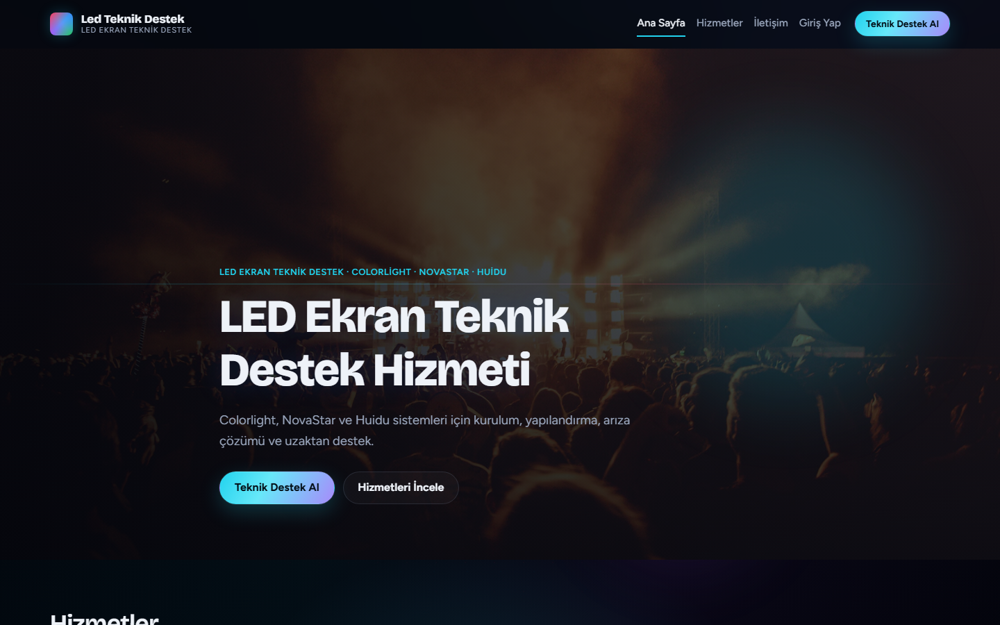
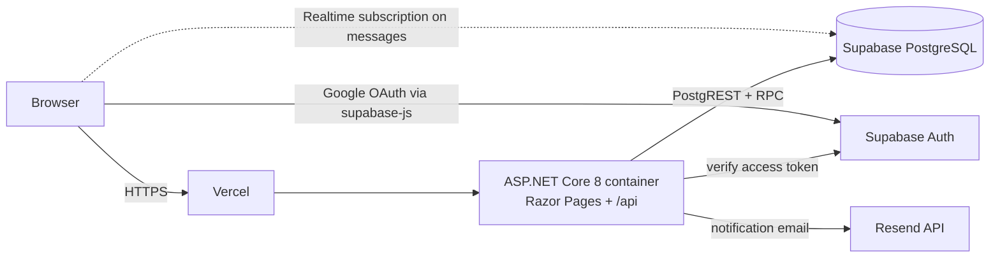
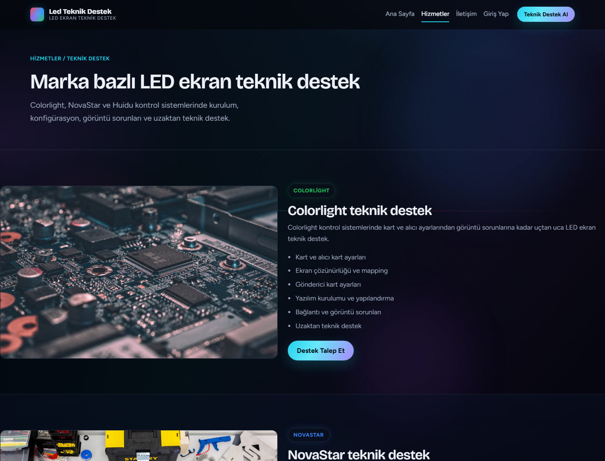
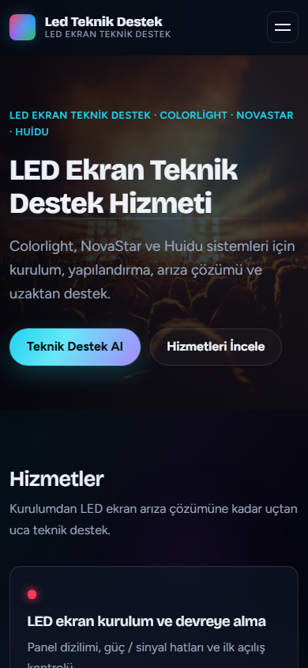
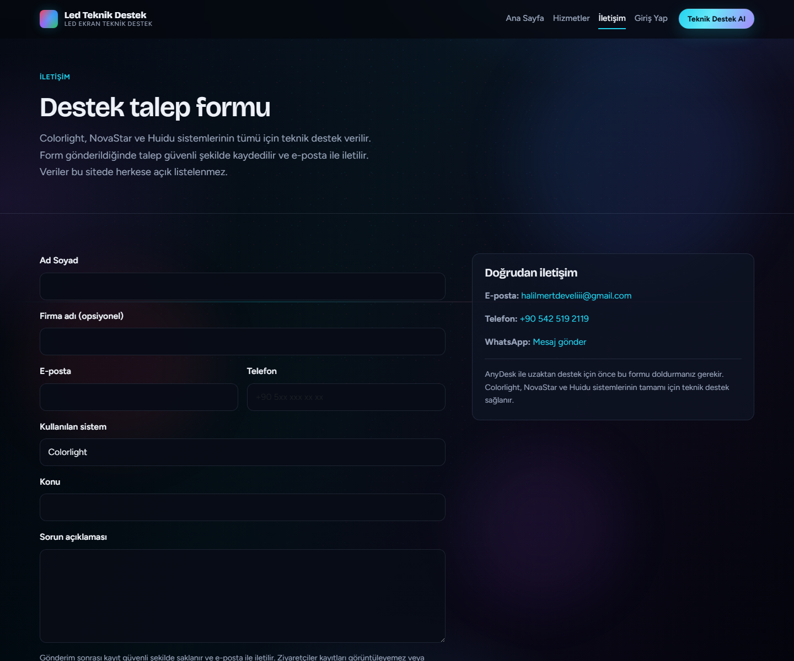
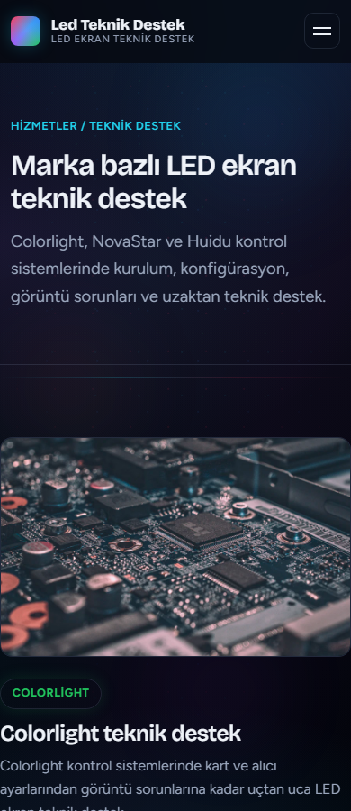
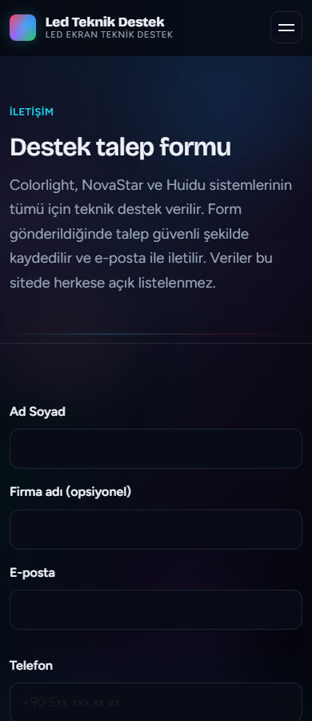

# LED Support Web

A Turkish-language technical support website for LED screen control systems (Colorlight, NovaStar, Huidu), built with **ASP.NET Core 8 Razor Pages** and backed by **Supabase** (PostgreSQL, Auth, Realtime) and **Resend** email.

**Live site:** https://asp-net-app-for-led.vercel.app



---

## Overview

The application is a public marketing and support site plus a small customer portal:

- Visitors read about supported LED control systems and remote-support options, and can send a support request through a contact form.
- Customers can sign in with Google, open support requests, and chat with the operator about each request.
- The operator (admin) sees customers, requests, and conversations in an admin panel and replies from there.

The UI text is in Turkish; code, configuration keys, and this README are in English.

## Problem & Solution

**Problem.** Technical support for LED screens is often handled ad hoc over phone and messaging apps. Requests get lost, there is no history per customer, and the operator has no single place to see what is open.

**Solution.** One web application that:

1. Stores every contact-form submission in PostgreSQL *before* sending the notification email, so a failed email does not lose the request.
2. Gives signed-in customers a request list and a per-request chat that updates in real time.
3. Gives the operator an admin panel over the same data, protected by a role check.

## Features

**Public site**
- Home, Services, and Contact pages. `/Products` and `/Support` permanently redirect to `/Services` (kept for old URLs).
- Content focused on Colorlight, NovaStar, and Huidu control systems, plus AnyDesk remote-support guidance.
- Contact form with server-side validation (data annotations), a honeypot field, an idempotency key, and a per-IP rate limit (default: 3 submissions per 15 minutes).
- SEO basics: page titles and meta descriptions, canonical and Open Graph tags, `robots.txt`, `sitemap.xml`.

**Contact-form pipeline**
- The submission is saved to the `support_messages` table first, then emailed to the operator through the Resend API with `Reply-To` set to the customer's address.
- Email delivery status is tracked per row (`email_status`: pending, sending, sent, failed). A "claim" step moves the row to `sending` before the email goes out, so posting the same submission twice does not send two emails.
- When the Supabase publishable key is configured, the app writes through ingest RPC functions; otherwise it writes to the table with the service-role key.

**Customer portal (requires sign-in)**
- Google sign-in through Supabase Auth. The browser completes OAuth with `supabase-js`, the server verifies the access token against Supabase (`/auth/v1/user`) and issues its own HTTP-only cookie.
- Account page (profile details, sign-out, account deletion).
- Create support requests and view their status.
- Per-request chat: messages are sent through the ASP.NET API; new messages appear live through a Supabase Realtime subscription on the `messages` table.
- The operator gets an email notification when a customer creates a request or sends a message.

**Admin panel (`/Admin`, `admin` role only)**
- Dashboard counts, request list with status filter, customer list and detail, conversation view with reply and status change.
- The admin role is assigned by a database trigger from an email allow-list (`private.admin_emails`). The app enforces it with an `AdminOnly` authorization policy on the `/Admin` folder and the `/api/admin` endpoints.

**JSON API (`/api`, cookie-authenticated)**
- Profile, requests, conversations, messages, and mark-as-read endpoints for customers; customer, request, and conversation listings for admins. Unauthenticated API calls get `401` instead of a login redirect.

## Tech Stack

| Layer | Technology |
|---|---|
| Web framework | ASP.NET Core 8 (Razor Pages + minimal API endpoints), C# |
| Front end | Server-rendered Razor views, Bootstrap 5.3 (CDN), custom CSS, vanilla JavaScript, `supabase-js` v2 (CDN) |
| Data | Supabase PostgreSQL through the PostgREST HTTP API (no ORM), row-level security, RPC functions |
| Auth | Supabase Auth with Google OAuth; ASP.NET Core cookie authentication for the app session |
| Realtime | Supabase Realtime (`postgres_changes` on `public.messages`) |
| Email | Resend HTTP API |
| Hosting | Vercel container runtime (`Dockerfile.vercel`) |

The project references no NuGet packages beyond the ASP.NET Core shared framework; Supabase and Resend are called with typed `HttpClient`s.

## Architecture



Contact form flow: `POST /Contact` → validation, honeypot, and rate-limit checks → insert into `support_messages` → claim the email send → Resend → record the email result on the row.

Project layout:

```text
src/LedSupport.Web/
  Pages/          Razor Pages (public site, account, requests, chat, Admin/)
  Api/            Minimal API endpoints under /api
  Services/       Supabase stores, account service, Resend email, auth cookie helper
  Options/        Strongly typed settings (Site, Support, Supabase, Resend, Smtp)
  wwwroot/        CSS, JS (auth, chat, contact), images, robots.txt, sitemap.xml
docs/supabase/    SQL snapshots of the schema, RLS policies, and triggers
docs/screenshots/ Screenshots used in this README
scripts/          PowerShell helper that sets local user-secrets interactively
legacy/           Earlier ASP.NET MVC prototype, kept for reference (not built or deployed)
```

## Screenshots

| Desktop | Mobile |
|---|---|
| Services<br/> | Home<br/> |
| Contact form<br/> | Services<br/> |
| | Contact<br/> |

The screenshots show the public pages only; the customer portal and admin panel are not pictured.

## Getting Started

### Prerequisites

- [.NET 8 SDK](https://dotnet.microsoft.com/download/dotnet/8.0)
- A Supabase project (storage, Google sign-in, realtime chat)
- A Resend account and API key (notification emails)
- Optional: Docker, to run the same container image used in production

### 1. Create the database objects

Run the SQL files in [`docs/supabase/`](docs/supabase/) in the Supabase SQL editor:

- `support_messages.sql` and `support_ingest_rpc.sql` for the contact form
- `account_messaging.sql` and `customer_portal.sql` for profiles, requests, conversations, messages, RLS policies, triggers, and the Realtime publication

Then enable the Google provider in Supabase Auth and add `<your-host>/Giris/Callback` (for example `http://localhost:5052/Giris/Callback`) to the allowed redirect URLs. To make yourself an admin, add your email to `private.admin_emails` before your first sign-in (see `account_messaging.sql`).

> The contact form's ingest RPC functions (`submit_support_message`, `claim_support_email_send`, `mark_support_email_result`, `find_support_message_by_idempotency`) are called by the code but are **not** included in `docs/supabase/`. See [Limitations](#limitations).

### 2. Configure secrets

Do not put real keys in `appsettings.json`. For local development use **user-secrets**; the command list is in [`src/LedSupport.Web/appsettings.Secrets.example.json`](src/LedSupport.Web/appsettings.Secrets.example.json):

```bash
cd src/LedSupport.Web
dotnet user-secrets set "Supabase:Url" "https://YOUR_PROJECT.supabase.co"
dotnet user-secrets set "Supabase:PublishableKey" "YOUR_SUPABASE_ANON_OR_PUBLISHABLE_KEY"
dotnet user-secrets set "Supabase:ServiceRoleKey" "YOUR_SERVICE_ROLE_KEY"
dotnet user-secrets set "Resend:ApiKey" "re_YOUR_RESEND_API_KEY"
dotnet user-secrets set "Resend:FromEmail" "Support <onboarding@resend.dev>"
dotnet user-secrets set "Resend:ToEmail" "you@example.com"
```

Or run the interactive helper: `powershell -ExecutionPolicy Bypass -File scripts/configure-support-secrets.ps1`.

You can also use **environment variables**; the template is [`.env.example`](.env.example). ASP.NET Core's double-underscore form works, and `Program.cs` also maps common aliases:

| Setting | Environment variable | Aliases accepted |
|---|---|---|
| Supabase URL | `Supabase__Url` | `SUPABASE_URL`, `NEXT_PUBLIC_SUPABASE_URL` |
| Publishable (anon) key | `Supabase__PublishableKey` | `SUPABASE_ANON_KEY`, `SUPABASE_PUBLISHABLE_KEY` |
| Service-role key (server only) | `Supabase__ServiceRoleKey` | `SUPABASE_SERVICE_ROLE_KEY`, `SUPABASE_SECRET_KEY` |
| Resend API key | `Resend__ApiKey` | `RESEND_API_KEY` |
| Sender address | `Resend__FromEmail` | `RESEND_FROM_EMAIL` |
| Operator inbox | `Resend__ToEmail` | `RESEND_TO_EMAIL`, `SUPPORT_EMAIL` |
| Public base URL (canonical and OG links) | `Site__BaseUrl` | none |

The service-role key is required for the customer portal, chat, and admin panel. Keep it on the server; only the publishable key is sent to the browser.

The committed `appsettings.json` contains defaults that point at the live Supabase project. Override `Supabase:Url` and `Supabase:PublishableKey` with your own project's values when running locally.

At startup the app logs which integrations are configured (log category `SupportStartup`) without printing secret values.

### 3. Run locally

```bash
dotnet restore src/LedSupport.Web/LedSupport.Web.csproj
dotnet run --project src/LedSupport.Web --launch-profile http
```

The site is served at http://localhost:5052 (the `https` profile also listens on https://localhost:7239).

To run the production image instead:

```bash
docker build -f Dockerfile -t led-support-web .
docker run --rm -p 8080:8080 --env-file .env led-support-web
```

## Deployment

Production runs on **Vercel's container runtime**:

- [`vercel.json`](vercel.json) defines a single `web` service with `runtime: container`, built from [`Dockerfile.vercel`](Dockerfile.vercel), and rewrites every path to it.
- `Dockerfile.vercel` is a two-stage build (`dotnet/sdk:8.0` → `dotnet/aspnet:8.0`) that publishes only `src/LedSupport.Web`. The app listens on `$PORT` (default 8080). Vercel terminates TLS, so the app reads `X-Forwarded-*` headers and does not redirect to HTTPS itself.
- Secrets (Supabase keys, Resend key) come from Vercel project environment variables. Non-secret defaults (base URL, sender, support mode) are `ENV` lines in `Dockerfile.vercel`.
- Vercel's Git integration deploys every push to `master` to production.
- [`.dockerignore`](.dockerignore) excludes `legacy/`, build output, and `.env` files from the image build context.

`Dockerfile` (without the `.vercel` suffix) is the same build without the Vercel-specific environment defaults, for running the image elsewhere.

## Testing

There is **no automated test suite** in this repository and **no CI workflow** (no `.github/workflows`). The quality gates today are:

- `dotnet build`, which completes with no warnings, and
- Vercel's container build on each push to `master`.

Verification so far has been manual, against the running site. Adding an xUnit project for the request pipeline (`DirectSupportRequestService`) and the API authorization rules, plus a GitHub Actions build, is the first item on the improvement list.

## Project Status

**Live.** The site is deployed at https://asp-net-app-for-led.vercel.app from the `master` branch and is maintained by one developer.

## My Contributions

I (Halil Mert Develi) own this repository and built the application:

- Built the Razor Pages site, the customer portal, and the admin panel.
- Moved persistence from an earlier Firebase setup to Supabase: schema, row-level security policies, and triggers (snapshots in `docs/supabase/`).
- Built the "store first, then email" contact-form pipeline with idempotency, duplicate-email protection, and email status tracking.
- Integrated Google sign-in (Supabase Auth → server-side token verification → ASP.NET cookie) and role-based admin authorization.
- Built the realtime chat (server-side writes, Supabase Realtime for live updates).
- Containerized the app and set up the Vercel container deployment with environment-based configuration.

Some commits were made with AI-assisted tooling (Cursor), as recorded in the commit history.

## Limitations

- **No automated tests or CI** (see [Testing](#testing)).
- **Incomplete SQL snapshots.** The ingest RPC functions listed under Getting Started live only in the deployed database. Because the publishable key is also needed for Google sign-in, a fresh setup with sign-in enabled uses the RPC path and needs those functions.
- **Ingest secret not sent.** `Support:IngestSecret` is read and reported at startup, but the store currently always sends an empty secret to the RPC functions.
- **Rate limiting is in-memory per instance.** If the platform runs several container instances, the per-IP limit is not shared between them.
- **Turkish-only UI.** There is no localization layer; strings are written directly in the Razor views.
- **Supabase-specific data access.** Data access is hand-written PostgREST calls; switching databases would mean rewriting the stores.
- **Client libraries from CDNs.** Bootstrap is loaded with SRI hashes, but `supabase-js` is loaded from jsDelivr by major version (`@2`) without an integrity hash.
- **Unused code paths.** `SmtpEmailSender` and `GitHubStatsService` are registered in `Program.cs` but not used by any page; Resend is the only email path in use.
- **Large `legacy/` folder.** It holds an earlier ASP.NET Core MVC prototype (onion architecture, SQL Server, .NET 10) and about 1,500 committed build-output files under `legacy/_buildcheck` (mostly DLLs). It is not part of the solution, the build, or the deployed image, and is a candidate for removal.
- **No license file.** All rights reserved unless a license is added.
